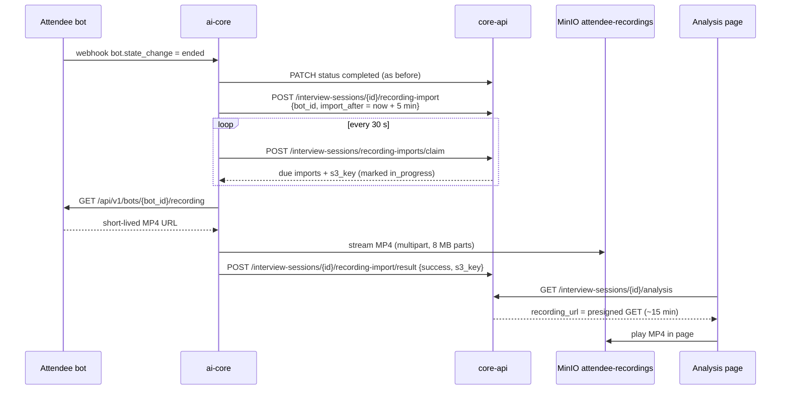

# Meeting Recording Storage

**Status:** Implemented
**Owner:** EZScreen
**Related:** [Attendee bot basics](https://docs.attendee.dev/guides/basics), [DB_DESIGN.md](./DB_DESIGN.md), [SETUP.md](../SETUP.md) §7.4

---

## 1. Summary

After an AI screening Meet ends, EZScreen waits **5 minutes** (configurable) and then copies Attendee's **MP4 recording** into **MinIO** (`attendee-recordings` bucket), using the same object-key layout as resumes. HR plays the video in the screening analysis page.

Live screening audio (websocket) is unchanged. Transcripts and scoring never wait on the copy. If the copy fails, the session is still complete.

## 2. Why

The Attendee bot already records every meeting, but EZScreen never kept the file:

- `interview_analysis.recording_url` and the analysis page's "Session recording" link existed, but nothing wrote the field.
- Attendee only returns a **short-lived** download URL, so it can't be stored as the permanent link.
- Hosted Attendee (`app.attendee.dev`) stores the file in its own short-term storage, so EZScreen must copy it to own a durable file.

## 3. Decisions

| Decision | Choice | Reason |
|---|---|---|
| Format | **MP4** (`recording_settings: {"format": "mp4"}` on every bot) | Product requirement; also Attendee's default. |
| When to copy | On webhook state **`ended`**, then wait **5 minutes** | Recordings are only downloadable after `ended`; the delay covers upload lag. |
| Who owns the state | **core-api**, in `interview_session.interview_metadata.recording_import` | ai-core never writes to Postgres directly; all its writes already go through core-api internal endpoints. |
| Worker | **One poller inside ai-core** (asyncio task started in the app lifespan) | State is in Postgres, so the poller alone survives restarts. No in-memory "fast path" needed; it adds at most one poll interval (30 s) to the 5-minute delay. No new container, queue or Redis. |
| Object key | `orgs/{org}/jobs/{job}/recordings/{session_id}.mp4` in a **separate bucket** | Videos are 0.5–3 GB; kept apart from resume PDFs. Built by core-api. |
| Stored in Postgres | The **MinIO key**, not a URL | `GET .../analysis` returns a fresh presigned URL (~15 min). |
| Attendee `delete_data` | **Not called** | Never delete Attendee's copy in case ours failed. |
| Sessions marked `failed`/`cancelled` | **Not copied** | Nothing useful to replay. |

## 4. Flow



## 5. Import state

`interview_session.interview_metadata.recording_import`:

```json
{
  "status": "pending | in_progress | complete | failed",
  "bot_id": "bot_...",
  "import_after": "2026-10-22T10:05:00+00:00",
  "attempts": 0,
  "claimed_at": null,
  "s3_key": null,
  "last_error": null
}
```

- **Schedule** is idempotent: a redelivered `ended` webhook doesn't restart an import that is `in_progress` or `complete`.
- **Claim** returns imports that are `pending` and due, plus `in_progress` ones older than `RECORDING_IMPORT_STALE_SECONDS` (ai-core restarted mid-copy). Rows are locked with `FOR UPDATE SKIP LOCKED`, so the same recording is never handed out twice.
- **Result**: success saves the key on `interview_analysis.recording_url` (creating the analysis row if needed); the key must match the claimed one. A retryable failure goes back to `pending` after `RECORDING_IMPORT_RETRY_SECONDS`, until `RECORDING_IMPORT_MAX_ATTEMPTS`; then `failed`.

## 6. Code

| Area | File |
|---|---|
| Ask Attendee for MP4 | `services/ai-core-services/src/meeting_bot/schemas.py` |
| Fetch recording URL | `services/ai-core-services/src/meeting_bot/attendee.py` (`get_recording_url`) |
| Schedule on `ended` | `services/ai-core-services/src/screening_pipeline/webhook_handler.py` |
| Poller + copy | `services/ai-core-services/src/screening_pipeline/recording_import.py` (started in `src/main.py`) |
| Streaming upload | `services/ai-core-services/src/core/storage.py` (`upload_stream`) |
| State + key | `apps/core-api/src/services/recording_import_service.py` |
| Internal endpoints | `apps/core-api/src/api/routes/interview_sessions.py` |
| Presign on read | `apps/core-api/src/services/interview_analysis_service.py`, `storage_service.py` |
| Video player | `apps/frontend/src/features/jobs/InterviewAnalysisPanel.jsx` |

## 7. Config

| Variable | Default | Service |
|---|---|---|
| `RECORDING_SAVE_DELAY_SECONDS` | `300` | ai-core |
| `RECORDING_IMPORT_POLL_SECONDS` | `30` | ai-core |
| `MINIO_BUCKET_RECORDINGS` | `attendee-recordings` | ai-core + core-api |
| `RECORDING_IMPORT_MAX_ATTEMPTS` | `5` | core-api |
| `RECORDING_IMPORT_RETRY_SECONDS` | `60` | core-api |
| `RECORDING_IMPORT_STALE_SECONDS` | `1800` | core-api |

`minio-init` already creates `attendee-recordings`. No database migration: the state uses the existing `interview_metadata` JSONB and `recording_url` columns.

## 8. Capacity (MinIO on this host)

Files stay until deleted or the disk fills. No retention policy is enforced yet.

| | Typical |
|---|---|
| 30-min 1080p MP4 | ~0.5–1.5 GB (plan ~1 GB) |
| 60-min | ~1–3 GB |
| Host free space (last check) | ~141 GB |
| Recordings before disk full | ~100–120 of 30-min screens |
| 100 screens/month kept 2 years | ~2.4 TB — this disk cannot hold that |

Resumes are negligible. Video dominates: plan backups and a retention policy (or a move to S3) before volume grows.

## 9. Out of scope

- Calling Attendee `delete_data` after a successful copy
- MinIO lifecycle / 2-year auto-delete
- 720p or MP3 options
- A live "importing recording…" indicator (the player appears once the copy is done; HR refreshes)

## 10. How to verify

1. Schedule a screening and let the bot record.
2. After the bot ends, `interview_metadata.recording_import.status` is `pending`.
3. Wait 5 minutes (locally: `RECORDING_SAVE_DELAY_SECONDS=30`).
4. MinIO console (`http://localhost:9003`) → `attendee-recordings` → `orgs/.../recordings/{session_id}.mp4`.
5. Open the application's screening analysis → the video plays in the page.
6. Restart ai-core during the delay → the copy still happens.
